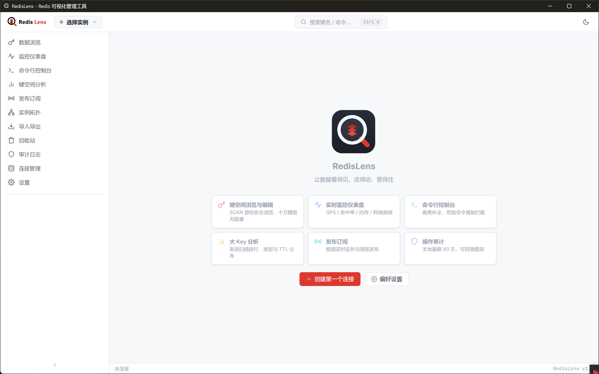
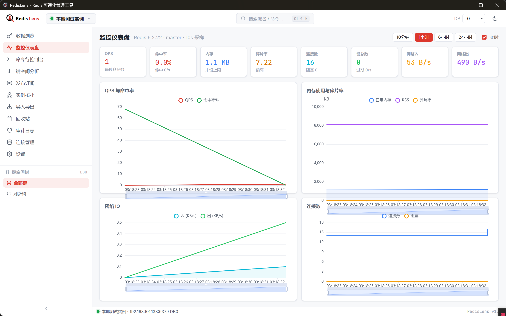
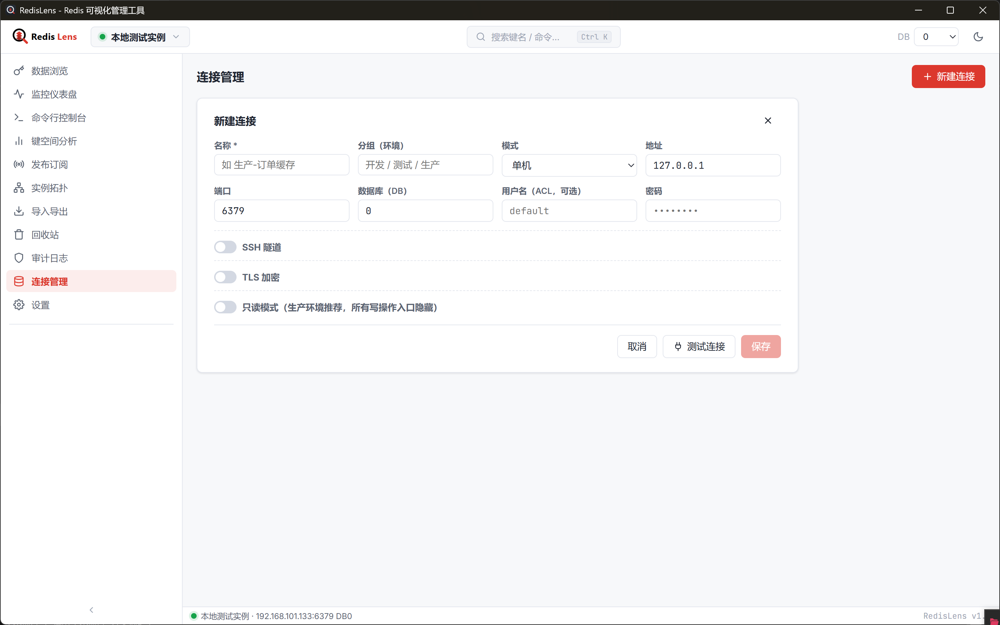
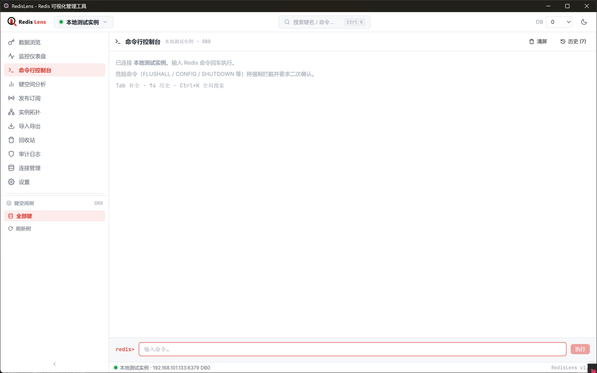
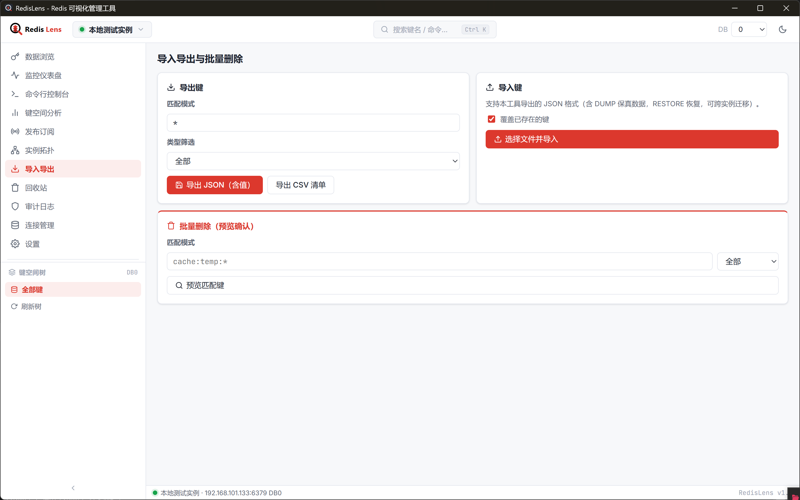

# RedisLens

> 面向开发与运维的一站式 Redis 可视化管理平台 —— 让数据看得见、改得动、管得住。

RedisLens 是一款基于 **Go + Wails v2 + Vue 3** 的 Windows 桌面版 Redis 可视化管理工具（对应产品 PRD V1.0 + V1.5 功能范围）。

## 功能总览

| 模块 | 能力 |
| --- | --- |
| 连接管理 | 多实例登记与分组、SSH 隧道、TLS、哨兵/集群模式、连接测试、只读模式、心跳探活与断线自动重连 |
| 数据浏览与编辑 | 键空间树（懒加载）、SCAN 游标分页（禁用 KEYS 全量扫描）、模式/类型筛选、五大类型 + Stream + RedisJSON 的查看与行内编辑、Diff 预览、虚拟滚动 |
| TTL 管理 | TTL 可视化、批量续期、移除 TTL（永久键正确显示"永久"） |
| 监控仪表盘 | INFO 周期采样（默认 10s）、QPS/命中率/内存/碎片率/连接数/网络 IO 曲线、时间窗口回看与拉框缩放 |
| 命令行控制台 | 语法高亮、命令+键名自动补全、会话历史、危险命令强制拦截与二次确认 |
| 键空间分析 | 大 Key 排行（内存/元素）、类型与 TTL 分布、慢查询日志、热命令统计 |
| 数据导入导出 | JSON（DUMP 保真，可跨实例恢复）/ CSV 导出、导入、批量删除预览确认 |
| 发布订阅 | 频道/模式订阅、实时消息流、消息发布 |
| 实例拓扑 | 单机主从 / 哨兵 / 集群分片自动发现 |
| 安全与审计 | 凭据 AES-256-GCM 本地加密（密钥机器绑定）、危险命令白名单拦截、操作审计日志（月度轮转，留存 ≥ 90 天）、回收站（删除键 DUMP 备份一键恢复） |
| 体验 | 浅色/深色主题一键切换、三档列表密度、Ctrl+K 全局搜索（键/命令/模块） |

## 界面预览

<table>
  <tr>
    <td></td>
    <td></td>
  </tr>
  <tr>
    <td align="center">欢迎页</td>
    <td align="center">监控仪表盘</td>
  </tr>
  <tr>
    <td></td>
    <td></td>
  </tr>
  <tr>
    <td align="center">连接管理</td>
    <td align="center">命令行控制台</td>
  </tr>
  <tr>
    <td></td>
    <td></td>
  </tr>
  <tr>
    <td align="center">导入导出与批量删除</td>
    <td></td>
  </tr>
</table>

## 在线文档

完整的产品介绍与使用手册：**<https://flairamos.github.io/RedisLens/>**

文档站是纯静态站点，源文件位于 `tools/docs-site/`，构建输出到 `docs/`：

```bash
# 修改 tools/docs-site/pages/*.html 后重新生成 docs/
node tools/docs-site/build.mjs
```

GitHub Pages 部署方式：仓库 **Settings → Pages → Build and deployment**，
Source 选择 **Deploy from a branch**，Branch 选择 `main`、Folder 选择 `/docs`，保存即可。
`docs/.nojekyll` 会关闭 Jekyll 处理，确保静态资源按原样发布。

## 产品文档

完整产品需求文档（PRD）：[`docs/RedisLens产品需求文档PRD.docx`](docs/RedisLens产品需求文档PRD.docx)
（版权所有 © 2026 flairamos）

## 技术栈

- **后端**：Go 1.26、[go-redis v9](https://github.com/redis/go-redis)、[Wails v2](https://wails.io)、golang.org/x/crypto（SSH 隧道）
- **前端**：Vue 3 + TypeScript + Vite、ECharts 5（图表）、@fontsource（Inter / JetBrains Mono 本地字体）
- **测试**：miniredis 单元测试 + 真实 Redis 5.0 实例集成测试
- **安全**：gosec / staticcheck / govulncheck 全部清零；凭据 AES-256-GCM（HKDF 派生 + 机器 GUID 绑定）

## 构建与运行

```bash
# 依赖：Go 1.26+、Node 22+、WebView2（Windows 自带）
go install github.com/wailsapp/wails/v2/cmd/wails@v2.10.1

# 开发模式
wails dev

# 生产构建（产物在 build/bin/）
wails build -platform windows/amd64

# 含 NSIS 安装包（需 makensis 在 PATH）
wails build -platform windows/amd64 -nsis
```

## 测试

```bash
# 单元 + 集成测试（自动探测本机 redis-server，无则回退 miniredis）
go test ./internal/... 
# 指定真实实例
REDISLENS_TEST_ADDR=127.0.0.1:6379 go test ./internal/rds
```

## 目录结构

```
├── main.go / app.go        # Wails 入口与绑定层
├── internal/
│   ├── config/             # 配置存储 + AES-256-GCM 凭据加密
│   ├── rds/                # Redis 服务层（连接/键/监控/控制台/分析/导入导出/PubSub/拓扑）
│   ├── audit/              # 审计日志（JSONL 月度轮转）
│   └── security/           # 命令分类与危险命令拦截
├── frontend/               # Vue3 前端（三栏式布局）
├── docs/                   # GitHub Pages 文档站（静态输出）
├── tools/docs-site/        # 文档源片段与生成脚本
├── tools/genlogo/          # 品牌图标生成器
└── build/                  # 构建产物（exe / NSIS 安装包）
```

## 兼容性

Redis 4.0 - 7.x（含 5.x 无 `SCAN TYPE`、多段 `INFO` 的自动降级）；Windows 10/11 x64。

## 许可

Apache-2.0 License
